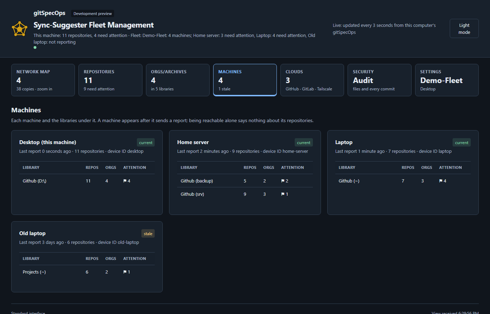
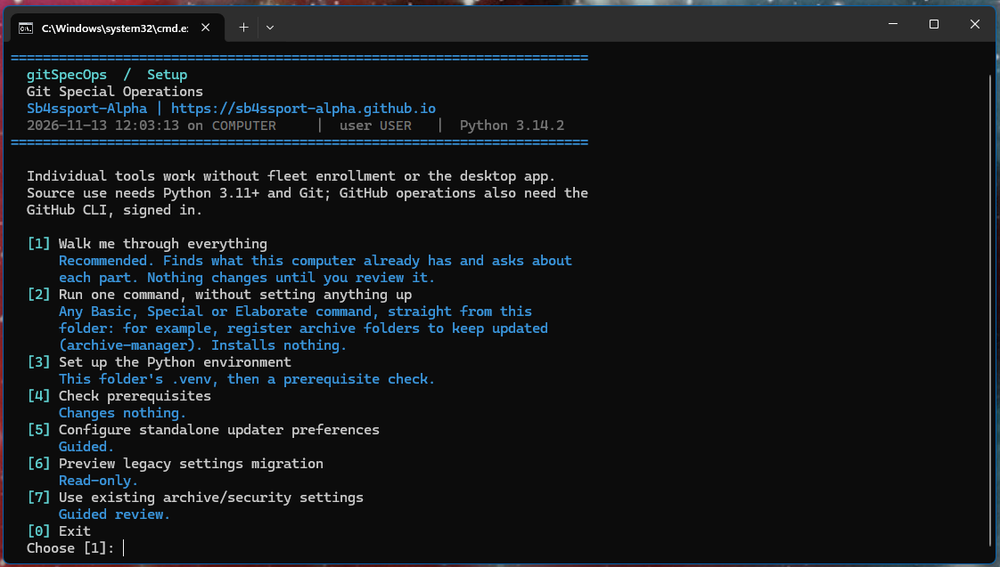

<p align="center"></p>

# gitSpecOps

**Git Special Operations: every copy of every Git repository you have, on every machine you
own, seen on one map, kept current, protected and coordinated.**

You have repositories on a laptop, a desktop, a server, maybe an old machine in a closet. Some
have work you never pushed. Some are behind. Some exist on one machine only. Some contain a
value that must never be published. gitSpecOps knows, shows you on one map, and asks you one
clear question about anything that needs you.

It sits beside tools like GitHub Desktop and Sourcetree. They work *deeply* in one repository;
gitSpecOps works *broadly*, across all of them and all your machines, and opens any repository
in your desktop Git app when you want to go deep.


*A made-up, messy fleet: every machine, owner and repository name in these pictures is invented.
See it yourself with `python _build/demo_fleet.py` (no setup; it reads nothing on your computer).*

> **Development preview.** Everything below marked *(planned)* is not built yet. Development and
> testing happen on Windows first; Linux and macOS are being verified now.

---

## How it works

1. **Every machine writes one small status file about its own repositories:** names, branches,
   and how far ahead, behind or uncommitted each copy is. Never file contents, never folder paths.
2. **Every machine reads everyone's files and draws the same map.** A machine that is switched
   off still appears, with its last report and how old that report is.
3. **The files travel however you like:** directly between your machines over Tailscale, through
   a folder your sync client already shares (OneDrive, Dropbox, Syncthing, a network share), or both.
4. **Git and the GitHub CLI do every real operation.** gitSpecOps looks, plans, checks and asks.

That is the whole system. Everything else is built on it in three layers, each using only the
one before:

| Layer | Means | For example |
|---|---|---|
| **Basic** | one Git or host operation, done carefully | commit, push, pull, clone; find every repository under a folder |
| **Special** | this machine, once | what needs attention here; catch up safely; secure-commit and secure-push |
| **Elaborate** | other machines, or over time | the fleet map; is this machine safe to wipe; start at sign-in |

Security sits alongside: `secure-commit` and `secure-push` check before anything leaves, and so
does every publish gitSpecOps makes on its own. Basic `commit` and `push` are plain, like git's.

## The page

Seven pages, one menu: each menu tile carries its number. The **Network map** is the picture;
every other page is a table that says each copy the same way, against its provider: "matches
GitHub", "12 behind GitHub", "4 uncommitted files", with the commit it is on beside it.

**Repositories and Orgs/Archives line every copy up**: one row per repository, one column per
library under each machine (a machine with two libraries gets two columns), and the provider
with its own commit. From the same row you can ask any machine to fast-forward what is simply
behind, or clone what it is missing, into the library you choose; the machine checks again
before it does anything, and another machine shows your request for approval.


**Machines** lists each machine with the libraries under it; **Clouds** lists the providers and
how the machines talk (Tailscale, a shared folder, a gitso-managed repository); **Security**
audits chosen repositories, files and every commit, and any group of repositories has an
"Audit these" button that takes them there; **Settings** changes this machine's setup.



## What never happens

- No force push, no `reset --hard`, no rebase, merge or delete as an automatic action, ever.
- Nothing changes a repository by itself. Watching only watches; every change is a command you
  ran, shown as a plan first.
- Nothing is scanned before you name the folders, and "find my libraries" looks only where you
  say, after you say so.
- No credentials stored: Git, `gh` and Tailscale use your own sign-ins.
- Nothing leaves your machine except what you chose to share: status facts, and repository names
  only if you allow them. Never paths, diffs, file contents or commit messages.

---

## Get started

You need **Python 3.11 or later** and **Git**. Everything else is optional and only for the
features that use it: the GitHub CLI (`gh`), Tailscale, a file-sync client, a secret scanner.

```sh
git clone https://github.com/sb4ssman/gitSpecOps
cd gitSpecOps
./run_setup.sh          # Windows: run_setup.bat; macOS: double-click run_setup.command
```

On macOS 11 and later setup installs the Qt build made for that macOS, for the menu-bar icon (not
yet tried on a Mac: so far only the icon-less mode has run there). Older Macs run without an icon
and the page is the way in (`gitso tray --open`).



Choose **Walk me through everything**: it finds what this computer already has, asks about each
part, and changes nothing until you have reviewed the whole list. Or set up, change or repair one
part on its own, or use the commands without installing anything. [Setup in detail](docs/SETUP.md).

---

## Grow as you go

gitSpecOps is useful with nothing set up, and every step multiplies what came before: a fleet of
four machines turns "see my repositories" into "see every copy, on all four, even the ones
switched off".

| | **Nothing set up** | **+ This machine** | **+ A fleet** | **+ Tailscale** |
|---|---|---|---|---|
| **You add** | nothing | your library folders | a fleet key and a way to share | your own tailnet |
| **Basic** | find repositories; status, fetch, pull, clone, commit, push, on any you name | | | |
| **Special** | check what needs attention; catch up; archives; copy an organization | an always-on map of this machine; recovery snapshots of unfinished work | | |
| **Elaborate** | | start at sign-in | every machine on one map; where work is unpushed; clone what is missing; prove a machine safe to wipe | live status between machines; the map on your phone |
| **Protect** | scans; secure-commit and secure-push; history cleanup | findings on the map, on request | audit every machine *(planned)* | |
| **Agents can** | work on folders you name | work on this machine | observe the whole fleet | |

Built: asking another machine to fast-forward or clone (it shows the request and acts on your
approval there). Planned: applying such requests automatically under a consent you set. A private
GitHub repository as a fourth way to share is built but **experimental and untested**.

## Commands

`gitso commands` lists them. At a terminal each shows a screen; run by a script or an AI agent,
each answers with one JSON record. Anything that changes things shows its plan first and acts
only on approval. [The command reference](docs/COMMANDS.md) has every command's own
description, generated from its source; [for AI agents](docs/FOR-AI-AGENTS.md) explains plans
and records.

Commands are `gitso <subject> <action>`; the Git ones keep Git's names. `gitso <subject>` lists
a subject's actions.

| Layer | Commands |
|---|---|
| **Basic** | discover, status, fetch, pull, clone, reset-keep, commit, push |
| **Special** | `machine` show / add / remove / find / presentation / check / catch-up / audit / materialize / buffers; `repo` name / list; `archive` add / remove / list / status / refresh / check / update / sync; `inventory` export / restore; `org copy`; `scan`; `review`; `history` scan / clean / follow / relink; `secure-commit`; `secure-push` |
| **Elaborate** | `machine safe-to-wipe`; `archive schedule`; `fleet` setup / status / transports / leave / key / baskets / git-client / join / doctor / preflight / publish / suggest / converge; `peer` run / rescan; `recovery`; `start-at-sign-in` |
| **App** | tray, serve-web, setup |

## Guides

- [Setup and requirements](docs/SETUP.md): installing, what gitSpecOps needs, the `gitso`
  command, setup without the walkthrough, updates.
- [The fleet](docs/FLEET.md): the tray and the map, how machines share, setting up and running
  a fleet, catching up, recovery.
- [Protect](docs/PROTECT.md): scans, secure-commit and secure-push, reviews, history cleanup.
- [Archives](docs/ARCHIVES.md): copying an organization, keeping folders of clones current.
- [For AI agents](docs/FOR-AI-AGENTS.md): plans, approvals and machine-readable results.
- [Command reference](docs/COMMANDS.md): every command's own description.
- [Architecture, safety model and tests](docs/ARCHITECTURE.md).

## License

GPL-3.0-only, with a commercial license available; see [`LICENSE`](LICENSE) and
[`NOTICE`](NOTICE). Changes: [`CHANGELOG.md`](CHANGELOG.md). Security problems: report them
privately, as [`SECURITY.md`](SECURITY.md) describes. Working on this repository, human or
agent? Start with [`.agents/README.md`](.agents/README.md).
