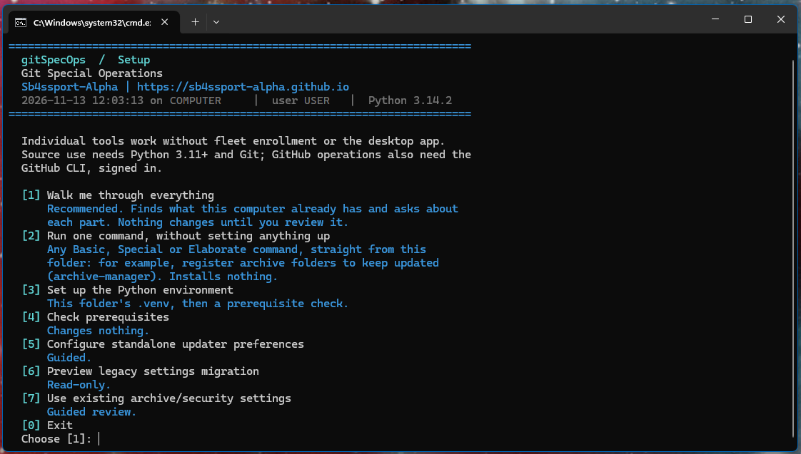

<p align="center"></p>

# gitSpecOps

**Git Special Operations: every copy of every Git repository you have, on every machine you
own, seen on one map, kept current, protected and coordinated.**

You have repositories on a laptop, a desktop, a server, maybe an old machine in a closet. Some
have work you never pushed. Some are behind. Some exist on one machine only. Some contain a
value that must never be published. gitSpecOps knows, shows you on one map, and asks you one
clear question about anything that needs you.

It sits beside tools like GitHub Desktop and Sourcetree. They work *deeply* in one repository;
gitSpecOps works *broadly*, across all of them and all your machines, and opens any repository
in your desktop Git app when you want to go deep.


*A hypothetical fleet: every machine, owner and repository name in this picture is made up.*

> **Development preview.** Everything below marked *(planned)* is not built yet. Development and
> testing happen on Windows first; Linux and macOS are being verified now.

---

## How it works

1. **Every machine writes one small status file about its own repositories:** names, branches,
   and how far ahead, behind or uncommitted each copy is. Never file contents, never folder paths.
2. **Every machine reads everyone's files and draws the same map.** A machine that is switched
   off still appears, with its last report and how old that report is.
3. **The files travel however you like:** directly between your machines over Tailscale, through
   a folder your sync client already shares (OneDrive, Dropbox, Syncthing, a network share), or both.
4. **Git and the GitHub CLI do every real operation.** gitSpecOps looks, plans, checks and asks.

That is the whole system. Everything else is built on it in three layers, each using only the
one before:

| Layer | Means | For example |
|---|---|---|
| **Basic** | one Git or host operation, done carefully | commit, push, pull, clone; find every repository under a folder |
| **Special** | this machine, once | what needs attention here; catch up safely; secure-commit and secure-push |
| **Elaborate** | other machines, or over time | the fleet map; is this machine safe to wipe; start at sign-in |

Security sits alongside: `secure-commit` and `secure-push` check before anything leaves, and so
does every publish gitSpecOps makes on its own. Basic `commit` and `push` are plain, like git's.

## What never happens

- No force push, no `reset --hard`, no rebase, merge or delete as an automatic action, ever.
- Nothing changes a repository by itself. Watching only watches; every change is a command you
  ran, shown as a plan first.
- Nothing is scanned before you name the folders, and "find my libraries" looks only where you
  say, after you say so.
- No credentials stored: Git, `gh` and Tailscale use your own sign-ins.
- Nothing leaves your machine except what you chose to share: status facts, and repository names
  only if you allow them. Never paths, diffs, file contents or commit messages.

---

## Get started

You need **Python 3.11 or later** and **Git**. Everything else is optional and only for the
features that use it: the GitHub CLI (`gh`), Tailscale, a file-sync client, a secret scanner.

```sh
git clone https://github.com/sb4ssman/gitSpecOps
cd gitSpecOps
./run_setup.sh          # Windows: run_setup.bat
```



Setup offers three ways in:

1. **Walk me through everything.** It finds what this computer already has (Git, the GitHub
   CLI and its sign-in, the desktop app, library folders, start at sign-in, a desktop Git app,
   protected values, secret scanners, Tailscale, a fleet), asks about each part, and changes
   nothing until you have reviewed the whole list.
2. **Run one command, without setting anything up.** Any Basic, Special or Elaborate command,
   straight from the folder, installing nothing: registering archive folders to keep updated, say.
3. **The `gitso` command.** A command of its own, beside `git` and `gh`, in any terminal. The
   walkthrough can put it on your command path (small text launchers in `~/.gitspecops/bin`, on
   every system), and optionally add it to your shells as an alias; it removes both just as
   easily. Without it, every command runs as `python gitso.py <command>`.

```sh
gitso commands             # every command, by layer
gitso docs suggest-sync    # what a command reads, may change, and returns
gitso suggest-sync         # this machine: what needs attention
```

---

## Grow as you go

gitSpecOps is useful with nothing set up, and every step multiplies what came before: a fleet of
four machines turns "see my repositories" into "see every copy, on all four, even the ones
switched off".

| | **Nothing set up** | **+ This machine** | **+ A fleet** | **+ Tailscale** |
|---|---|---|---|---|
| **You add** | nothing | your library folders | a fleet key and a way to share | your own tailnet |
| **Basic** | find repositories; status, fetch, pull, clone, commit, push, on any you name | | | |
| **Special** | check what needs attention; catch up; archives; copy an organization | an always-on map of this machine; recovery snapshots of unfinished work | | |
| **Elaborate** | | start at sign-in | every machine on one map; where work is unpushed; clone what is missing; prove a machine safe to wipe | live status between machines; the map on your phone |
| **Protect** | scans; secure-commit and secure-push; history cleanup | findings on the map, on request | audit every machine *(planned)* | |
| **Agents can** | work on folders you name | work on this machine | observe the whole fleet | |

Also planned: keeping repositories current automatically under a consent you set; asking
another machine to act, live over Tailscale or when it next wakes. A private GitHub repository
as a fourth way to share is built but **experimental and untested**.

---

## The tray and the map

One tray icon, one colour, one meaning:

| Colour | Means |
|---|---|
| Green | This machine and the fleet are in order. |
| Amber | Something waits for one decision from you. |
| Red | Something is wrong; the tooltip says what. |

Double-click opens the map in your browser, served only on this computer. Right-click to rescan,
preview a catch-up, start at sign-in, or quit.

The map shows your machines and the copies they hold. Copies of the same repository line up
across machines, so "ahead here, behind there, missing on that one" is visible at a glance.
Switch views: a zoomable map of clouds and machines; machines together; libraries; one
organization across machines; one repository across machines. Choose any machine as the point
of view. The **Security** tab scans the repositories you tick, and shows each scanner you could
add with the command that installs it on your system.

---

## Protect

Publishing a repository publishes its whole history, not just today's files. gitSpecOps checks
before anything leaves:

- **Scans** of the working files, the staged bytes, or the full history, with built-in checks
  and, if you have them, Gitleaks, Betterleaks (version 1) or TruffleHog.
- **`secure-commit` and `secure-push`.** A commit carries exactly the files you named; a push
  sends exactly the planned commits. Both are held by a secret, a value on your never-publish
  list, or an unreviewed binary. (Basic `commit` and `push` do the same Git work without the
  checks, as `git` itself would.)
- **Reviews.** Accept one finding at one exact place, once; it is not a blanket exception.
- **History cleanup.** Rewrite history into a new private copy, prove what changed, rescan, and
  only then publish; afterwards your clones follow the new history, and the commit ids quoted in
  your files are updated.

## For AI agents

`gitso` is built so an agent can work with your repositories as safely as you can:

```sh
gitso suggest-sync --json          # this machine: what needs attention
gitso suggest-fleet-sync           # every machine
gitso scan-tree <repo> --json      # findings, masked
gitso secure-commit <repo> <files> -m "…"   # a plan with an id; nothing happens yet
gitso secure-commit <repo> <files> -m "…" --apply --approve <plan id>
gitso docs <command>               # what a command reads, may change, and returns
```

- **Every command says what it does** before it does it: what it reads, what it may change,
  where results go.
- **Plans, then approval.** Anything that changes a repository first returns a plan with an id;
  applying requires that exact plan, and a changed repository invalidates it.
- **The same gates as you.** An agent using `secure-commit` and `secure-push` passes the same
  security checks, so it cannot publish what must not leave.
- **Machine-readable** results with `--json`, and no prompts when every choice is a flag.

## Commands

`gitso commands` lists them; each also runs by its own path, for example
`python Special/suggest_sync.py --help`. [The command reference](docs/COMMANDS.md) has every
command's own description, generated from its source.

| Layer | Commands |
|---|---|
| **Basic** | discover, status, fetch, pull, clone, reset-keep, commit, push |
| **Special** | enroll-machine, suggest-sync, name-repo, catch-up, audit-repos, materialize, list-live-buffers, duplicate-org, update-archive, archive-manager, sync-archive, export-inventory, restore-inventory, scan-tree, scan-history, review-finding, clean-history, follow-rewrite, secure-commit, secure-push |
| **Elaborate** | setup-fleet, peer, publish-status, suggest-fleet-sync, converge, check-safe-to-wipe, recovery, doctor, preflight, start-at-login, schedule-archives |
| **App** | tray, serve-web, setup |

## Updates

Running from a clone, `git pull` brings the latest version; your settings live outside the
folder, so an update never touches them. Downloadable releases that update themselves are
*(planned)*.

---

# In depth

## Requirements and hard assumptions

| | |
|---|---|
| **Python 3.11+** | The command-line tools use only the standard library. The tray needs Qt (PySide6), which setup installs into this folder's `.venv` with `uv`. |
| **`git` on PATH** | Every Git operation runs your real `git`. |
| **`gh`, already signed in** | Only for anything that talks to GitHub. |

**Authentication is yours and stays yours.** gitSpecOps stores no token, writes no credential
file, configures no keyring, and never prompts for a password. It runs CLIs you have already
signed in to (`gh auth login` is yours to run). If `gh` is not signed in, GitHub features decline
to run; they never ask you for a secret.

- Anything GitHub-specific (organization listing, repository creation, following renames) needs
  `gh`. Plain archive updating needs only `git`, and works against any host.
- `GIT_TERMINAL_PROMPT=0` is forced everywhere, so a repository with expired credentials fails in
  under a second instead of hanging on an invisible prompt.
- Every subprocess has a timeout. Nothing blocks unbounded.

## Setup without the walkthrough

Updater preferences can be configured without enrolling this machine:

```sh
python3 _build/setup_gitspecops.py settings
python3 _build/setup_gitspecops.py settings-preview --root /path/to/archive --no-log --json
python3 _build/setup_gitspecops.py settings-save --root /path/to/archive --no-log --json --approve '<review-id>'
```

Guided setup reviews changes and requires typed `SAVE`. For assisted use, copy the preview id
and keep the same target and options when saving; changed files invalidate it. Paths are hidden
unless `--show-paths` is given. `settings-migration-preview` inspects an older profile's
mapping. For an archive and security profile from an older version, use the reviewed
existing-settings setup:

```sh
python3 _build/setup_gitspecops.py settings-existing
python3 _build/setup_gitspecops.py settings-existing-plan --json
```

The plan changes nothing. Guided saving requires separate confirmation that older writers are
stopped and the launcher plan was reviewed, then typed `SAVE`; assisted use has
`settings-existing-save --approve '<review-id>' --legacy-writers-stopped --launcher-plan-reviewed`.
The original bytes are kept under the selected user-data folder before shared settings are
created. `settings-existing-status --switch-id '<review-id>'` inspects an interrupted switch, and
`settings-existing-resume` finishes it. Add `--settings-home /path/to/profile` to select a
profile. Profiles with existing fleet configuration need a separately reviewed conversion
(`gitso setup-fleet convert`).

## Security in detail

Scans use your saved security policy and print masked results without writing reports or logs:

```sh
gitso scan-tree /path/to/repo --json
gitso scan-history /path/to/repo --json
```

- **Engines.** Built-in checks need no extra packages. Choose optional engines with repeatable
  `--engine gitleaks`, `--engine betterleaks` or `--engine trufflehog`; `--engine none` overrides
  the saved choice. A selected engine that is missing or unsupported makes the scan
  *incomplete*, never a pass. Nothing is installed automatically.
- **Protected values.** Saved never-publish values always apply; `--never-publish` files add to
  them, `--safe-file` and `--safe` add allowances, and conflicting values are an error.
  `security.repository_exceptions` lets one repository contain named protected values on purpose
  (a personal site that names a project); every other repository still blocks them.
- **Reports.** `--out` writes a full private JSON report, only where you say: outside Git, storage
  you control; inside Git, an ignored and untracked path. Existing files and links are refused.
- **Older profiles.** `--legacy-policy` reads an unmigrated profile's text lists without changing
  them.

**Reviews.** For a documented example or a test fixture, review that exact finding:

```sh
gitso scan-tree /path/to/repo --out /private/reports/scan.json --json
gitso review-finding /private/reports/scan.json finding-000001 --reason "Reviewed example"
```

The preview writes nothing; rerun with `--apply --approve <plan id>`. Changed bytes, location or
repository need review again. Protected values, strong credentials, unsupported engine findings
and coverage gaps cannot be waived. A binary file (a font, an executable) is a "binary content"
finding: its readable strings are checked, and a review accepts that exact file at that place.
PDFs and 7z/RAR archives remain coverage gaps. Revoke with `--revoke <review id>`. Reviews stay
on this machine.

**Staged bytes.** If Git's line-ending conversion or a clean filter changes a reviewed file when
staged, `scan-tree --staged --out FILE` inspects exactly what would be committed. It never stages
or commits anything.

**`secure-commit`.** Preview the files, message and author, then apply that exact plan:

```sh
gitso secure-commit /path/to/repo file.py docs/usage.md -m 'Describe the change' --json
gitso secure-commit /path/to/repo file.py docs/usage.md -m 'Describe the change' --apply --approve '<plan-id>'
```

Only the named files are committed, with their whole working contents; other staged work is
kept. Existing hooks run in their usual order through a temporary relay; no hooks or Git
settings are installed. Requires Git 2.36 or later. Directories, linked files, merge or rebase
states need compatibility work. If Git created a commit but final verification fails, the result
says `partial`; nothing is pushed or undone automatically.

**`secure-push`.** `gitso secure-push /path/to/repo --json` previews the branch, tip and destination
without network access; `--apply --approve '<plan-id>'` fetches, checks the actual outgoing
history through the same gate as archive publishing, then pushes that fixed snapshot. There is
no force, extra-tag or bypass option.

**Status with security.** `gitso publish-status check --root /path/to/library --local-only
--no-publish --no-catalog --json` reports Git status together with local findings. Only the
status manifest is ever shared; findings stay on this machine. The map's **Check local
security** runs the same checks on observed repositories, in memory only.

**History cleanup** is dangerous maintenance and is built to be hard to misuse. It rewrites only
a new private mirror, never the source, and never publishes:

```sh
gitso scan-history /path/to/repo --out /private/history.json --json
gitso clean-history plan /private/history.json --choices /private/choices.json --include-remote-refs --plan-out /private/plan.json --json
gitso clean-history apply /private/plan.json --workspace /private/new-run --approve PLAN_ID
```

`gitso docs clean-history` gives the choices format. Apply needs an attended terminal and typed
`REWRITE`; there is no `--yes`. Remaining findings or gaps hold the result for review. A verified
mirror does not rotate credentials, erase other copies or update other clones: publishing it is
your step, and `gitso follow-rewrite` then moves your clones onto it.

## Archives

### Copy an organization

```sh
gitso duplicate-org
```

Downloads every repository in an organization, uploads a folder of local repositories into one,
or migrates organization to organization. Previews, checks for name collisions before any remote
call, asks for typed confirmation, and writes resumable run files so an interrupted migration
continues instead of restarting.

### Keep archives current

```sh
gitso update-archive --root /path/to/archive
gitso archive-manager --list
gitso archive-manager --install /path/to/archive --mode update
```

**Fast-forward pulls only.** A repository that is dirty, diverged, or on an unapproved remote is
reported and skipped, never "fixed". `update-archive` uses only `git` and updates what is on
disk, with any host. `sync-archive` asks GitHub (via `gh`) what *should* be there, so it can
also clone what is missing, repair stale origins after a rename, and rename folders to match
upstream, each as a separate, explicitly approved kind of change. If discovery fails it falls
back to updating only; it never invents a clone, an orphan or a rename from a failed listing.
Identity is by stable provider id, never by folder name or URL.

`archive-manager` registers archives, refreshes them in their saved mode, and installs
per-archive launchers; `schedule-archives` sets up a monthly refresh. Registrations live in your
per-user gitSpecOps folder (`%APPDATA%\gitspecops` on Windows, `~/.config/gitspecops` elsewhere;
`GITSPECOPS_HOME` overrides), never in the checkout, so a scheduled refresh keeps working when
the code moves. Output goes to the terminal by default; reports and counts-only logs are opt-in.
Use `--scan-only` to look without changing anything.

### Publishing archives

```sh
gitso sync-archive --root /path/to/archive --publish --dry-run
```

`--publish` pushes without force, so Git itself refuses anything that is not a fast-forward.
Only clean, ahead-only repositories are eligible, the exact outgoing history is checked first,
and the remote is fetched again just before pushing. It cannot be combined with other changes,
or run by a launcher or a scheduled task. Nothing is ever committed automatically.

## The fleet in detail

Every machine observes itself and writes **one file that it alone owns**; no machine is in charge
of another. That single-writer rule is why there is no conflict-resolution code anywhere here.

| Way to share | What carries the status | Needs | Gives you |
|---|---|---|---|
| **Tailscale** | your machines, directly | Tailscale | near-real-time; readable machine names |
| **A synced folder** | a folder your sync client already replicates | any sync client | fast; no account |
| **A managed repository** (experimental, untested) | a private GitHub repository, never cloned | your `gh` sign-in | status kept while every machine is off |

Use as many as you can: each is another place a machine leaves its last report.

```sh
gitso enroll-machine          # this machine's library folders
gitso setup-fleet             # join or start a fleet; choose how to share
gitso suggest-fleet-sync      # every machine, as text
gitso tray                    # the peer behind a tray icon, with the map
gitso serve-web               # the map without a tray
```

**The map is local and needs nothing else running.** It is served on this computer only, from
whatever status files it can read. A laptop shut for a week still appears, with its last known
state and an honest "three days old". With your consent, the map can also be opened from your own
Tailscale devices, and only those. See [the fleet guide](docs/FLEET.md).

**Catch up safely** after time away:

```sh
gitso catch-up                # a fresh fetch and a plan; changes nothing
gitso catch-up --apply --yes  # fast-forward only clean, behind-only checkouts
```

Dirty, untracked, ahead, diverged, detached, unreadable and failed-fetch checkouts are listed for
you and never altered. Catch-up never commits or pushes. Stop the local peer first; the fleet's
lock enforces that.

**What crosses the wire.** Repositories are identified by `HMAC-SHA256(fleet key,
host/owner/name)`, or for one with no usable remote, an HMAC of its root commit, so the only copy
of something is still on the map. By default each record also names the repository, its branch
and its commit, so every machine can show what the others hold. One setting (`--withhold-names`,
or "no" during setup) turns that off. Never shared, either way: local paths, URLs, file names,
diffs, commit messages or contents. A synced folder's provider can read whatever the status
carries; setup says so beside the question. Details:
[`.agents/knowledge/manifest-privacy.md`](.agents/knowledge/manifest-privacy.md).

- **Silence is never good news.** A report too old to trust never produces an "all clear"; stale
  unfinished work keeps its warning.
- **Machine freshness and remote freshness are separate clocks**, and the map says which is which.

The fleet key is shown only when you ask: `gitso setup-fleet fleet-key --show`. Anyone, or any
program, that reads it can join your fleet.

## Safety model

- **Fast-forward only, everywhere.** Pulls are `--ff-only`; every push is a non-force push.
- **Detect, show the plan, approve, run, review.** Failures are collected and reported at the
  end. Nothing ambiguous is applied automatically.
- **Destructive-adjacent actions are interactive only** and need typed confirmation; scheduled
  and launcher runs cannot reach them.
- **A tray item or a map button runs the same command as the terminal**, with the same plan and
  confirmation. Operations that change repositories refuse to run beside a live peer.
- **Bounded everything:** timeouts, bounded discovery and thread pools, non-interactive Git.
- **Your credentials stay yours.** No token is read, stored, forwarded or logged.

## Layout

```text
gitso.py      the front door: every command, by name
Basic/        one Git or host operation, done carefully
Special/      this machine, once
Elaborate/    other machines, or over time
App/          the tray (Qt) and the map (web view)
_os/          per-system pieces, the same files for Windows, Linux and macOS
docs/         the fleet guide, the display contract, recovery design, README images
_build/       setup, the desktop packaging recipe and release check
tests/        offline and synthetic; no network, no real repositories
.agents/      project brief, working notes, work log, durable knowledge
```

A file without an underscore is a command, runnable by its own path and listed by `gitso`;
anything with one is plumbing. Everything below `App/` is standard-library Python.
`Elaborate/_fleet/display.py` is the only module that turns fleet state into what the map and
tray show; every face reads that versioned contract.

**Kept out of the checkout:** settings, registrations, fleet state and logs live in your
per-user gitSpecOps folder (`GITSPECOPS_HOME` or `GITSPECOPS_SYNC_HOME` override). Generated and
never committed: `.venv/`, `Special/duplicate_org/runs/`, `.agents/output/`.

## Tests

Every test is offline and synthetic: no network, no real repository, no personal name.

```sh
python3 tests/run_all.py            # several files at once (up to 4), each in its own process
python3 tests/run_all.py --jobs 1   # one at a time, output as it happens
```

## Contributing and license

Working on this repository, human or agent? Start with [`.agents/README.md`](.agents/README.md)
and the living [`.agents/WORKING-NOTES.md`](.agents/WORKING-NOTES.md). What changed in each
version: [`CHANGELOG.md`](CHANGELOG.md). Found a security problem? Report it privately, as
[`SECURITY.md`](SECURITY.md) describes.

Licensed under the GNU General Public License, version 3 only (GPL-3.0-only): use it, study it,
change it and share it, and share anything you distribute that builds on it under the same terms.
To build gitSpecOps into a product that is not GPL-3.0, ask for a commercial license by opening
an issue on this repository. Versions up to commit `cacee74` were released under Apache 2.0 and
remain so. See [`LICENSE`](LICENSE) and [`NOTICE`](NOTICE).

Contributions are welcome. Because gitSpecOps is also offered under a commercial license, a
contribution can be accepted only with the contributor's agreement that it may be distributed
under both.
