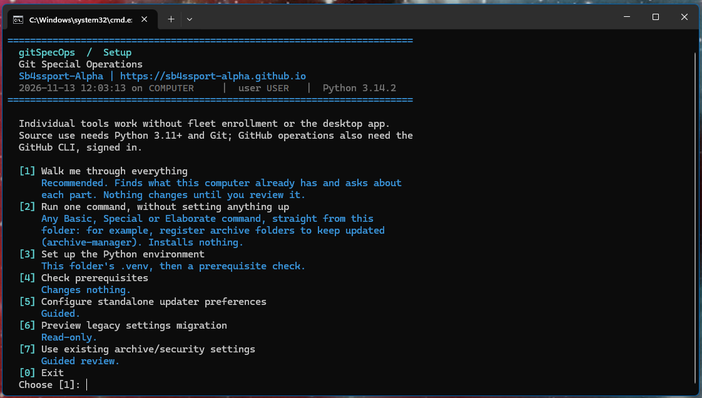

# Setup and requirements

How to install and run gitSpecOps, what it needs, and how to set it up without the walkthrough.

## Get started

You need **Python 3.11 or later** and **Git**. Everything else is optional and only for the
features that use it: the GitHub CLI (`gh`), Tailscale, a file-sync client, a secret scanner.

```sh
git clone https://github.com/sb4ssman/gitSpecOps
cd gitSpecOps
./run_setup.sh          # Windows: run_setup.bat
```



Setup offers three ways in:

1. **Walk me through everything.** It finds what this computer already has (Git, the GitHub
   CLI and its sign-in, the desktop app, library folders, start at sign-in, a desktop Git app,
   protected values, secret scanners, Tailscale, a fleet), asks about each part, and changes
   nothing until you have reviewed the whole list.
2. **Run one command, without setting anything up.** Any Basic, Special or Elaborate command,
   straight from the folder, installing nothing: registering archive folders to keep updated, say.
3. **The `gitso` command.** A command of its own, beside `git` and `gh`, in any terminal. The
   walkthrough can put it on your command path (small text launchers in `~/.gitspecops/bin`, on
   every system), and optionally add it to your shells as an alias; it removes both just as
   easily. Without it, every command runs as `python gitso.py <command>`.

```sh
gitso commands             # every command, by layer
gitso docs suggest-sync    # what a command reads, may change, and returns
gitso suggest-sync         # this machine: what needs attention
```

## Requirements and hard assumptions

| | |
|---|---|
| **Python 3.11+** | The command-line tools use only the standard library. The tray needs Qt (PySide6), which setup installs into this folder's `.venv` with `uv`. |
| **`git` on PATH** | Every Git operation runs your real `git`. |
| **`gh`, already signed in** | Only for anything that talks to GitHub. |

**Authentication is yours and stays yours.** gitSpecOps stores no token, writes no credential
file, configures no keyring, and never prompts for a password. It runs CLIs you have already
signed in to (`gh auth login` is yours to run). If `gh` is not signed in, GitHub features decline
to run; they never ask you for a secret.

- Anything GitHub-specific (organization listing, repository creation, following renames) needs
  `gh`. Plain archive updating needs only `git`, and works against any host.
- `GIT_TERMINAL_PROMPT=0` is forced everywhere, so a repository with expired credentials fails in
  under a second instead of hanging on an invisible prompt.
- Every subprocess has a timeout. Nothing blocks unbounded.

## Setup without the walkthrough

Updater preferences can be configured without enrolling this machine:

```sh
python3 _build/setup_gitspecops.py settings
python3 _build/setup_gitspecops.py settings-preview --root /path/to/archive --no-log --json
python3 _build/setup_gitspecops.py settings-save --root /path/to/archive --no-log --json --approve '<review-id>'
```

Guided setup reviews changes and requires typed `SAVE`. For assisted use, copy the preview id
and keep the same target and options when saving; a changed settings file invalidates it. Paths
are hidden unless `--show-paths` is given. Add `--settings-home /path/to/profile` to select a
profile.

## Updates

Running from a clone, `git pull` brings the latest version; your settings live outside the
folder, so an update never touches them. Downloadable releases that update themselves are
*(planned)*.

[Back to the README](../README.md)
